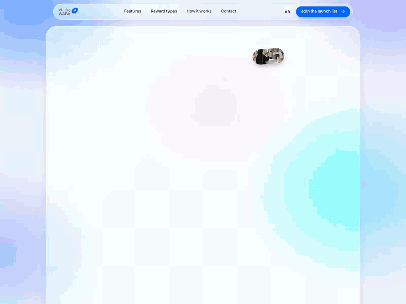
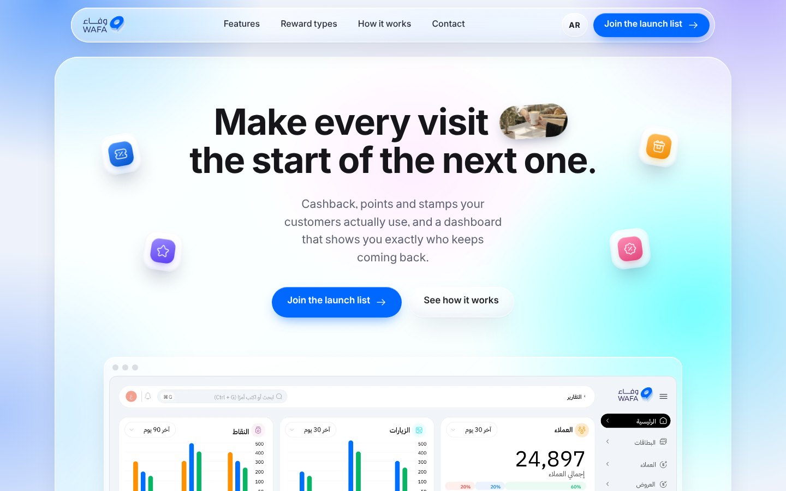
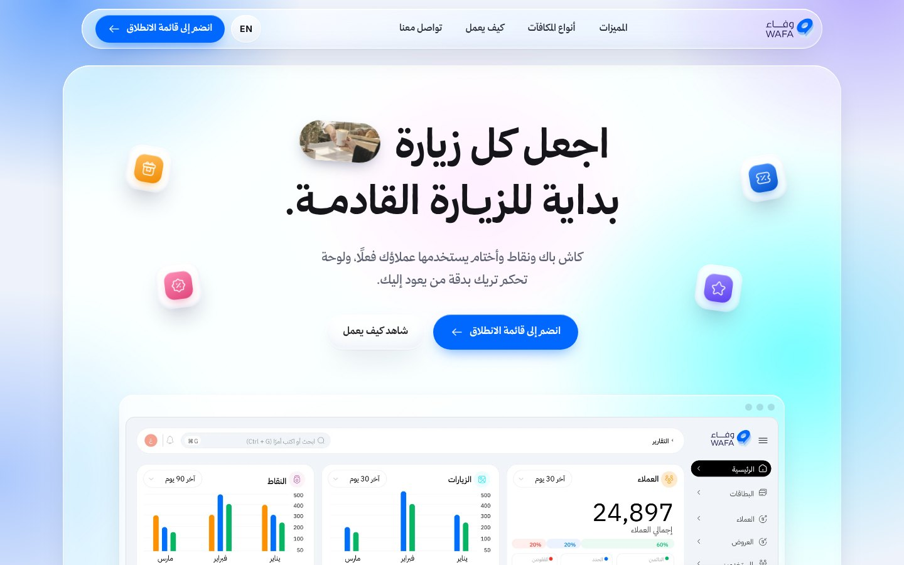
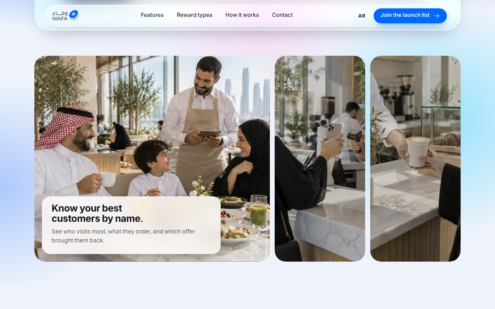
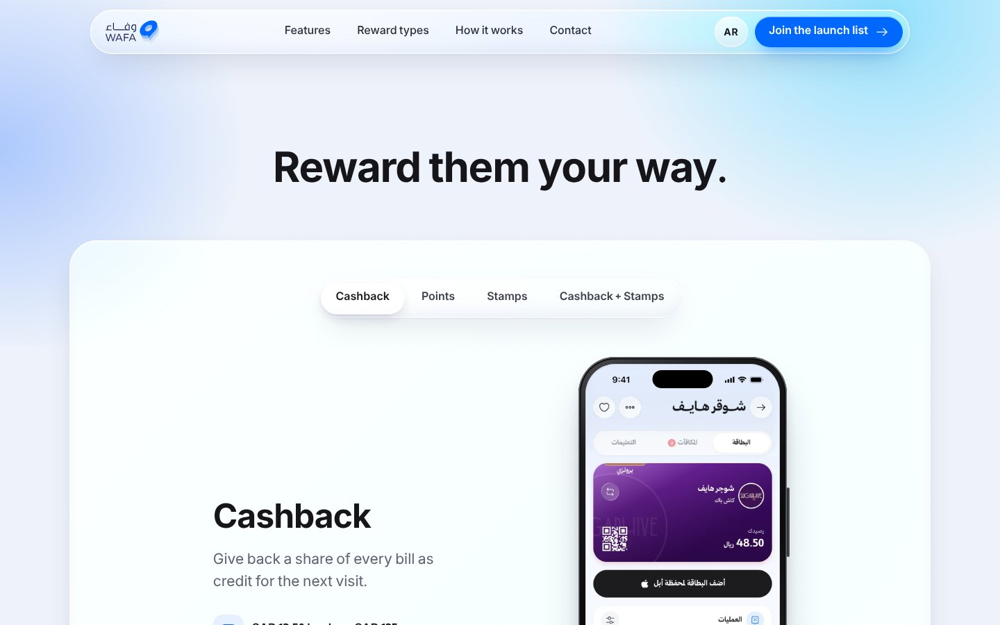
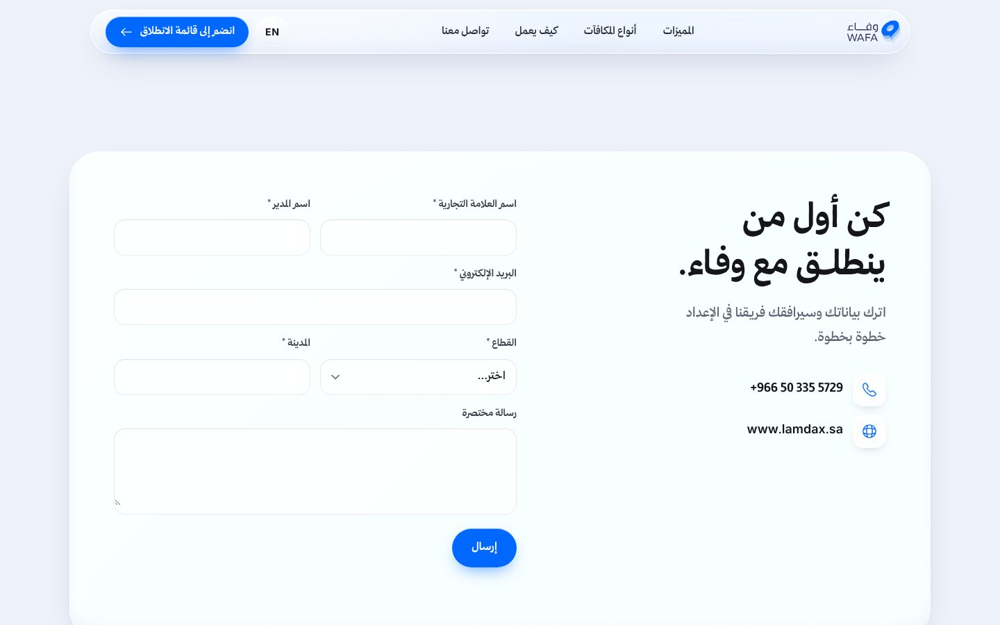
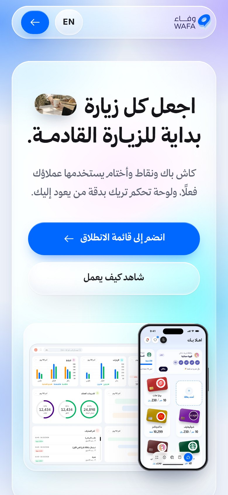
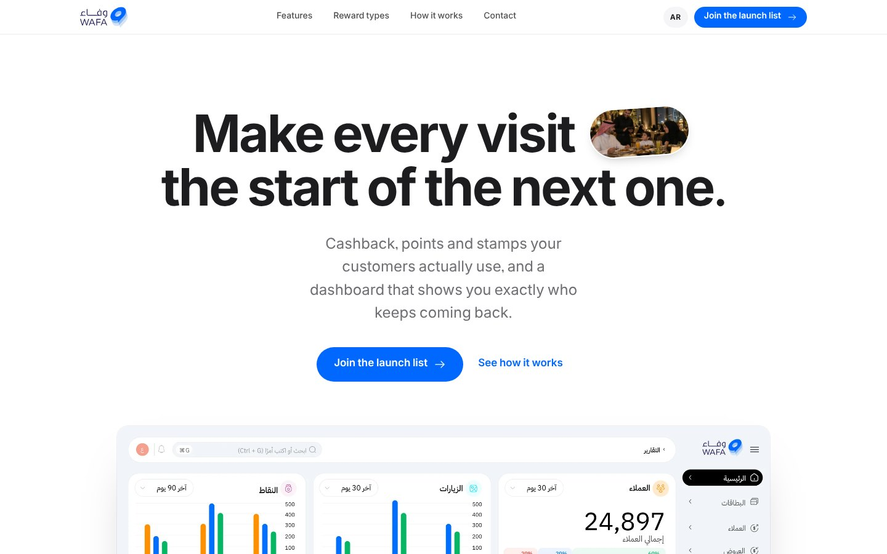

# Wafa | وفاء

Landing page for **Wafa**, the loyalty app that lets shops reward customers their way: cashback, points, stamps, or cashback and stamps together. Built in Arabic and English, with a liquid-glass look and smooth animation.

**Live site:** https://abdallahzezo77.github.io/wafaa/



## Screenshots

| English | العربية |
| --- | --- |
|  |  |

### Photo panels
Hover a photo and it widens while its caption fades in.



### Reward types
A glass tab bar slides between Cashback, Points, Stamps and Cashback + Stamps, and the phone shows the matching app screen.



### Join the launch list
Waitlist form with brand name, manager name, email, industry, city and a short message.



### Mobile



## Versions

| Version | Link | Preview |
| --- | --- | --- |
| Morning (main) | [index.html](https://abdallahzezo77.github.io/wafaa/) |  |
| Night | [versions/night.html](https://abdallahzezo77.github.io/wafaa/versions/night.html) |  |
| Elegant (Apple-style) | [versions/elegant.html](https://abdallahzezo77.github.io/wafaa/versions/elegant.html) |  |

## Features

- **Arabic and English:** one EN / AR button switches the whole page, including right-to-left layout. Add `#ar` or `#en` to the link to open a language directly.
- **Brand font:** The Year of Handicrafts for all text, with stretched letters (kashida) on Arabic headings.
- **Liquid glass:** frosted nav, cards and buttons with a light rim and a sheen that follows the mouse.
- **Animation:** headline words fade in, a photo capsule cycles inside the headline, floating icon tiles follow the mouse, and sections reveal as you scroll. All motion turns off for visitors who prefer reduced motion.
- **Real product:** screens come from the Wafa app and merchant dashboard designs.
- **No build step:** plain HTML, CSS and JavaScript. Open `index.html` or host the folder anywhere.

## Structure

```
index.html          Morning version (main)
versions/           Night and Elegant versions
assets/             App screens, photos and fonts
screenshots/        Images used in this README
```

## Notes

- The waitlist form validates input but is not connected to a backend yet.
- The App Store and Google Play badges are placeholders until the store links are live.
- Contact: +966 50 335 5729 · www.lamdax.sa
